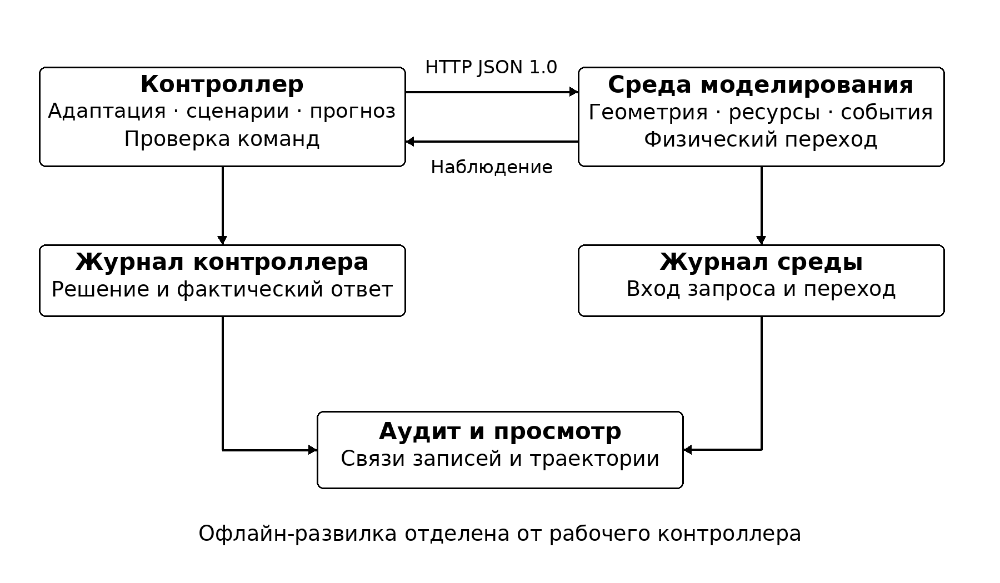
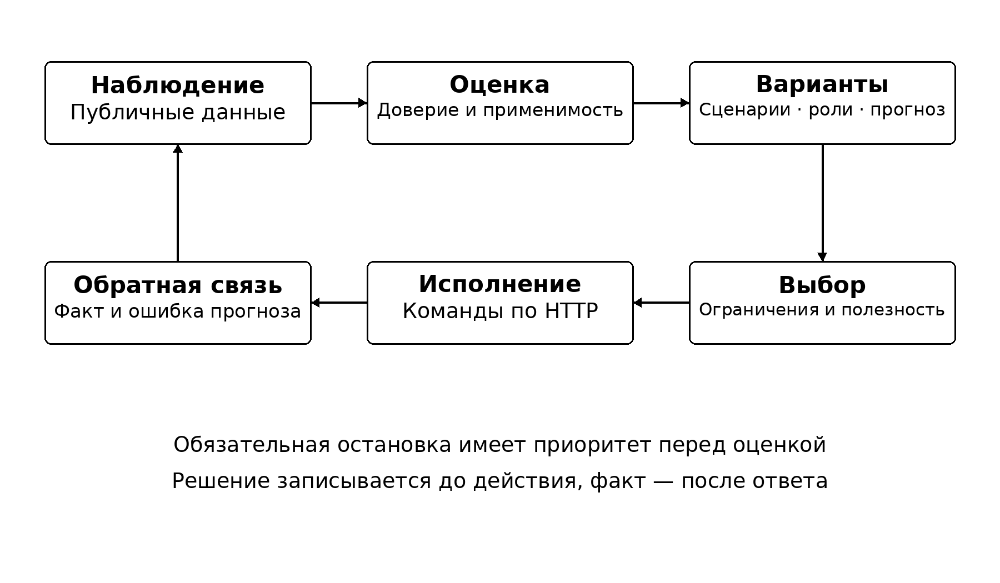

# Программный комплекс Ариадна

Пояснительная записка. Внутреннее обозначение АРИАДНА.09.01.81. Версия программы 0.9.0. Редакция документа от 12.11.2026. Разработчик: Заречкин Артём Алексеевич, группа Б24-507.

## Аннотация

Ариадна — программный стенд для исследования кооперации неоднородных автономных агентов. Среда моделирования и контроллер работают отдельными процессами и обмениваются публичными наблюдениями и командами по HTTP. Полевые поисково-спасательные миссии и домашняя карта «Квартира 42» показывают один цикл управления в разных условиях.

Ключевой метод — сравнение вариантов плана до исполнения по публичной прогнозной модели и проверка прогноза после получения результата. Дополнительная «Развилка» воспроизводит альтернативы в собственной среде из общего состояния. Она отделена от рабочего контроллера.

Записка раскрывает архитектуру, пять классов сценариев, игровые модели, протокол, ограничения и методику проверки. Результаты относятся к модельным испытаниям; реальных межкомандных и натурных испытаний нет. Детальные измерения и первичные журналы приведены в программе и протоколе испытаний.

## 1 Введение

Основание разработки — техническое задание хакатона «Метарой 1.0» и формальная спецификация версии 1.0 [1, 2]. Задача состоит в создании самостоятельной A2X-среды и системы метасценарного управления. A2X обозначает взаимодействие автономных агентов с другими агентами, инфраструктурой, вычислительными сервисами и человеком.

Структура записки учитывает ГОСТ 19.105-78, ГОСТ 19.404-79 и расширенный перечень раздела 16 ТЗ [3, 4]. Программа испытаний организована по ГОСТ 19.301-79, инструкция — по ГОСТ 19.505-79 [5, 6]. Идентификаторы документов являются внутренними обозначениями проекта. Сведения об утверждении не заменяются вымышленными подписями.

## 2 Назначение и постановка задачи

Цель — сохранять выполнение общей миссии при изменении обстановки, состава группы, доступности связи и ресурсов. Для этого требуется оценивать входные данные, выбирать и изменять сценарии, распределять роли, проверять команды и связывать решение с наблюдаемым результатом.

Среда должна скрывать необнаруженные цели и будущие события, проверять допустимость команд и поддерживать воспроизводимость. Контроллер должен работать через публичный интерфейс без чтения внутреннего состояния симулятора. Внешний контроллер не обязан импортировать библиотеку Ариадны.

Комплекс предназначен для модельных исследований, обучения разбору решений и регрессионной проверки алгоритмов. Области предполагаемого переноса — спасательные операции, инспекция, доставка и домашняя робототехника. Работа с физическими роботами требует отдельной интеграции и проверки безопасности.

## 3 Предметная область и миссии

Полевой процесс включает обнаружение цели, подтверждение и доставку помощи. Цели имеют приоритеты; скрытые координаты публикуются после обнаружения. Доставка требует подтверждения, подходящего исполнителя, доступного канала и достаточного груза. Отказы, новые зоны, изменения приоритетов и директивы меняют условия выполнения.

Пять полевых карт — forest, quarry, city, snow, delta. Текущие демонстрационные расстановки используют дополнительные звенья и объёмные корпуса. Новые цели могут появляться во время эпизода. Версия карты и её SHA-256 фиксируются вместе с журналами, поэтому результаты разных расстановок нельзя сравнивать только по названию карты.

Квартира размером 24 × 16 м содержит пять помещений и пять дверей, девять мобильных роботов, штаб, оператора и инфраструктуру. В «Ключе к вентилю» вода закрывает прямой вход, а курьер идёт через кабинет и служебную дверь. В «Свете после отключения» ретранслятор возвращает связь. В «Закрытой двери» оператор закрывает оба прохода кабинета и отменяет выезд. Исполнение отмены оценивается отдельно от успешной доставки.

## 4 Архитектура среды и управления

Environment управляет эпизодом, проверяет запросы и записывает переходы. Simulation вычисляет движение, ресурсы, связь, события и выполнение задач. Геометрия и события квартиры задаются модулем home; пользовательские полевые карты — custom_maps. HTTP-приложения связывают эти компоненты с внешними процессами.

PortableController получает capabilities, нормализует публичную семантику и вызывает планировщик. Scenarios, predicates и beliefs отвечают за библиотеку, применимость и доверие. CounterfactualController сравнивает прогнозы. Public model и guard проверяют команды до отправки; среда повторяет проверку независимо.

Рабочий контур и отдельный контур анализа показаны на рисунке 1. Контроллер не получает доступ к закрытым координатам и будущему расписанию через исследовательские средства.



Viewer читает публичные снимки и показывает миссию, решения, сеть, корпуса и журналы. Новый расчёт запускает Python-сервер студии; открытие HTML без сервера воспроизводит сохранённые записи. Research восстанавливает собственную модель для офлайн-ветвления и не участвует в принятии текущих команд.

## 5 Онтология агентов и объектов

Базовые категории — aerial, ground, underground, surface_water, underwater, infrastructure, digital и operator. Агент содержит идентификатор, категорию, состояние, способности, ресурсы, канал, роли, доступные действия и ограничения. У цифрового агента и оператора position равен null. Их привязка к сети задаётся отдельно.

Инфраструктура включает ретранслятор, зарядную станцию, сенсорный узел, базовую станцию и вычислительный узел. Наличие compute_node включается параметром include_compute_node. Он обрабатывает ограниченные задачи усреднения через обычные сетевые сообщения; это не произвольное выполнение программ.

Ресурсы — нормированные энергия, запас доставки, запас станции и вычислительный бюджет. Зоны задаются осевыми трёхмерными коробками с типом, стоимостью, риском и правилами доступа. Объект миссии проходит состояния unconfirmed, confirmed, delivered. Цели и директивы входят в публичную модель миссии.

Поддерживаются 14 типов событий: отказы и деградация агентов, отказ инфраструктуры, потеря связи, смена приоритетов, директива, появление опасности или запрета, дефицит ресурса, обнаружение и изменение цели, противоречивая и устаревшая информация, изменение окружения. Космическая категория cosmic объявляется расширением ariadna.cosmic.v1; её условная высотная кинематика не является орбитальной моделью.

## 6 Пространство время связь и физика

Координаты измеряются в метрах, время — в секундах. Оси x и y горизонтальны, z направлена вверх. Пространство непрерывное; собственная среда публикует переходы через 1 с. Движение внутри шага линейное. Пересечения проверяются вдоль отрезка, включая относительное движение двух агентов.

В стандартном rescue_v2 скорости воздушного, наземного, подземного, надводного и подводного агента равны 6, 3, 2, 4 и 2 м/с. Деградация уменьшает скорость вдвое. Резерв энергии — 0,15; базовые радиусы сенсора, взаимодействия и зарядки — 12, 1 и 3 м. Зарядка передаёт до 0,1 энергии за шаг из конечного запаса; доставка расходует 0,25 груза. Для других карт и сред действуют их опубликованные пределы.

В полевой физике solid_v1 корпус и зазор 0,12 м учитываются при маршрутизации и столкновениях. Порог сильного удара — 3 м/с для воздушного и 2 м/с для остальных мобильных полевых агентов по нормальной скорости сближения. Лёгкий контакт допускает проверенный отъезд на 0,145 м; сильный переводит агента в failed. В квартире контакт приводит к отказу. Это кинематические правила, а не модель разрушения материалов. Старые карты без solid_v1 сохраняют прежнюю модель для воспроизводимости архивных журналов.

Ячеистая сеть пересчитывается по активным узлам и геометрии. В стандартном профиле дальность — 35 м. Промежуточный узел должен поддерживать relay. Маршрут сообщения выбирается детерминированным поиском в ширину; задержка составляет шаг на ребро. Разрыв исходного пути или заданная потеря уничтожают сообщение без автоматической повторной маршрутизации.

Потеря связи блокирует новые команды и публикацию находок, но не скрывает автоматически все ранее доступные состояния. Географическая привязка, распространение радиоволн и динамика жидкости не моделируются.

## 7 Сценарии и игровые модели

Библиотека состоит из пяти исполнимых классов. Декларации scenarios/library.json сверяются с hackroi/scenarios.py. Сценарий включает участников, роли, действия, цели, ограничения, предикаты входа, продолжения и выхода, переходы и игровую модель. Предикаты представлены ограниченным AST без eval.

Игровая модель задаётся как G = ⟨N, A, I, U, K, Θ, E⟩: участники, действия, информация, полезность, ограничения, неопределённость и критерий выбора. Информация ограничена текущим и ранее полученными публичными наблюдениями. E реализован как детерминированный выбор положительного допустимого прироста с фильтром безопасности; доказательство общего равновесия Нэша не заявляется.

Таблица 1 - Обязательные классы сценариев

| Идентификатор | Назначение | Роли |
|---|---|---|
| coverage_search | Поиск новых участков | scout |
| priority_service | Подтверждение и доставка | executor, verifier |
| relay_coalition | Восстановление связности | relay, beneficiary |
| safe_degradation | Возврат и зарядка | returning, charging, holding |
| coordination_reconfiguration | Переназначение координации | coordinator, member |

Для поиска полезность равна 10·new_cell·confidence − 0,05·distance − 2·energy_cost; для обслуживания — 20·priority·confidence·(0,5 + 0,5·reliability) − 0,05·distance − 2·energy_cost. Коалиция оценивает 15·newly_connected_members, восстановление — 30·recoverable_agents с теми же штрафами расстояния и энергии. Координатор выбирается по 10·reliability + 5·energy + degree − reassignment_cost. Числа являются коэффициентами модели, а не физическими величинами.

Общие ограничения — одна команда агенту за шаг, резерв, геометрия, связь и директивы. При арбитраже восстановление предшествует ретрансляции, обслуживанию и поиску. Координатор удерживается при разнице полезности до 3 единиц и минимальном сроке 3 такта, пока остаётся доступным. Полные формализации приведены в SCENARIOS.md и машинной библиотеке.

## 8 Метасценарный контроллер и прогноз

На каждом шаге контроллер оценивает качество наблюдения, выделяет события, проверяет применимость сценариев, строит роли и команды, фильтрует ограничения и выбирает метаоперацию. Операции keep, select, switch, modify, compose, synthesize и safe_stop различаются в решении и журнале. Синтез создаёт ограниченный исполнимый граф из известных примитивов; генерации произвольного кода нет.

Цикл принятия решения показан на рисунке 2. Контрфактический штаб сравнивает четыре политики: meta, frontier, nearby и reserve. Для каждой строятся обычный и стрессовый прогнозы на шесть шагов. Равнозначные варианты могут использовать общий вычисленный прогноз.



Оценка сочетает выполнение, прирост информации и затраты: 100·discounted_completion + 3·information_proxy·confidence − 3·energy − 8·exhausted − 4·stop. Дисконтирование равно 0,95, гистерезис выбора — 0,05. Новые скрытые цели не подставляются в прогноз; информационный выигрыш оценивается приближённым покрытием.

После исполнения сравниваются выполнение, энергия, позиции, состояния и связность. Калибровка использует наблюдаемые остатки; при доверии ниже 0,35 применяется метаплан без доверия к прогнозному ранжированию. Эмпирическая полоса ошибки энергии по истории до 64 значений не является статистической гарантией. Если агентов больше 24 или публичных целей больше 48, многовариантный прогноз пропускается, а защита и маршрутизация сохраняются.

Офлайн-развилка использует одинаковый снимок собственной среды и зафиксированные намерения. Это иной эксперимент, чем повторный запуск полной политики после каждого шага. Его измерения не передаются рабочему контроллеру как сведения о будущем.

## 9 Протокол взаимодействия

Публичный транспорт — HTTP с JSON UTF-8 и protocol_version 1.0. Восемь маршрутов обеспечивают готовность двух компонентов, capabilities, reset, observation, step, logs и close. Семь схем в contracts включают отдельную reset_response: минимальный нормативный ответ reset не обязан содержать поля результатов step.

Request_id задаёт идемпотентность в пределах живого процесса среды. Идентичный повтор возвращает сохранённый ответ; другое тело с тем же идентификатором отклоняется. Лимит — 2048 изменяющих запросов, без вытеснения. После перезапуска кэш не восстанавливается. Клиент не повторяет POST автоматически после потери ответа.

Собственная среда применяет пакет атомарно. Для чужой среды частичное исполнение допустимо только при явном объявлении batch=partial и configuration=atomic и точном сопоставлении результатов с командами. Проверяются эпизод, запрос и модельное время.

Расширения motion, energy, rescue, cosmic, home и compute объявлены через capabilities; прогнозные и адаптерные свидетельства являются необязательными блоками решений и журналов. Их поля, пределы, действия и примеры сведены в PROTOCOL.md. Проверочный a2x.public-model.v1 — локальная договорённость проекта, а не дополнительный официальный стандарт.

## 10 Ограничения доверие и неопределённость

Guard проверяет действия, параметры, доступность исполнителя и канала, энергию, груз, достижимость, препятствия и конфликты движения. После удаления конфликтного движения проверка повторяется с учётом остановившегося агента. Среда независимо проверяет запрос и физический переход.

Доверие учитывает репутацию источника, давность, согласованность и наблюдаемую надёжность исполнения. При уверенности ниже 0,55 уменьшается шаг и запрашивается подтверждение перед доставкой. Сообщение не превращается в команду автоматически. Обязательная остановка имеет приоритет перед полезностью доставки.

Для базового публичного профиля без дополнительных пределов адаптер использует ограниченные плановые допущения: скорость 2 м/с, расход 0,01 на метр и 0,005 за такт, радиус взаимодействия 0,75 м, сенсора 4 м. Они не являются измерениями чужой физики и не гарантируют успешность. Воздушные, подводные и подземные агенты используют XYZ-границы опубликованной зоны; поверхностные сохраняют высоту.

Неизвестные обязательные ограничения и неподдерживаемые единицы вызывают безопасную реакцию. Поиск пути ограничен 128 коробками, 520 узлами видимости и кэшем до 2048 маршрутов. Плотная конфигурация может безопасно заблокироваться; полнота многоагентного планирования не доказана.

## 11 Журналирование и аудит

Среда и контроллер записывают JSON Lines. Решение сохраняет публичное наблюдение и его SHA-256, прежнюю и выбранную конфигурации, кандидатов, причины, роли, проверки, команды и ожидаемый эффект. Фактический ответ связывается по episode_id, decision_id и request_id. Прогноз фиксируется до действия, ошибка — после него.

Аудитор сверяет последовательность наблюдений, команды и результаты между журналами, воспроизводит выбор и проверяет прогнозные свидетельства. При записи используются flush и fsync до фиксации перехода. Журнал не заменяет транзакционную базу; автоматическое восстановление прерванного эпизода не реализовано.

Для сравнения фиксируются версия, карта, seed, режим и run_id. Собственные значения округляются до 12 знаков; документированная точность численного сравнения — 1e−9. Побайтовое совпадение локальных запусков не считается доказательством идентичности всех платформ.

## 12 Контрольные образцы и программа экспериментов

FixedController использует фиксированный режим и координатный порядок целей. ReactiveController выбирает по приоритету, расстоянию и энергии, без библиотеки метасценариев. Оба исполняют обязательную остановку и получают те же публичные данные. Они являются учебными контрольными алгоритмами, а не сильнейшими доступными решениями.

Текущая проверка включает модульные и HTTP-тесты, согласованность схем и библиотеки, повторный аудит поставленных записей, девять домашних и пятнадцать полевых прогонов. Внутри пары сохраняются карта, seed и начальное состояние. Статусы success, time_limit, safe_stopped и error учитываются раздельно. Программа, команды и результаты находятся в TEST_PROTOCOL.md.

Результаты старых выпусков 0.4–0.8 сохраняют свои версии и исходные хеши. В частности, сравнение 17,5 и 14 шагов относится к историческому holdout версии 0.4.0 и не используется как новая оценка 0.9.0.

## 13 Результаты испытаний

Повторная проверка от 12.11.2026: все 200 тестов кода пройдены; все 24 домашних и полевых прогона прошли аудит. Пять полевых миссий штатного контроллера завершены за 57, 48, 44, 46 и 55 с модельного времени. Fixed и reactive на каждой из этих карт достигают лимита 180 с. Эти измерения получены текущим кодом на текущих расстановках, а не перенесены из отчётов этапов.

На трёх домашних задачах штатный контроллер завершает две миссии и исполняет отмену третьей. Контрольные алгоритмы на первых двух достигают лимита времени, а на третьей также останавливаются. Время остановки не сравнивается со временем успешной доставки как единая метрика эффективности.

Перекрёстная инженерная проверка использует поставленную локальную реализацию interop/peer.py с иной семантикой. Она проверяет адаптацию и обработку ошибок, но не является испытанием с другой командой. Число реальных внешних команд равно нулю, официальный балл и допуск жюри не установлены.

## 14 Ограничения отказы и границы применимости

Кинематика не воспроизводит гидродинамику, ветер, материалы, механику приводов и достоверную радиосреду. Условные единицы энергии не переводятся непосредственно в аккумуляторную ёмкость. Поиск и прогноз имеют ограниченный горизонт; часть наблюдаемых состояний глобальна даже при потере связи.

Карты и сценарии спроектированы автором. Одно фиксированное начальное значение на карте не даёт статистической оценки вероятности успеха. Исторические ошибки baselines не подменяют результаты повторной проверки текущей версии. Работа в других сферах показана переносом модельного подхода, а не подтверждённым внедрением.

Серверы предназначены для локального стенда и по умолчанию слушают 127.0.0.1. Они не предоставляют производственную аутентификацию и защиту публичного сервиса. Межкомандная совместимость и полный официальный турнир требуют отдельной проверки на согласованных внешних средах.

## 15 Ожидаемые технические и экономические показатели

Ожидаемый практический эффект — меньше затрат на разбор ошибок и сравнение вариантов до натурного запуска. Проверять его следует временем диагностики, количеством повторов, полнотой воспроизведения и трудозатратами интеграции. Исследование с внешними пользователями и денежная оценка не проводились.

Численные модельные результаты не позволяют вычислять число спасённых людей, стоимость реальной операции или гарантированное снижение аварийности. Для такой оценки нужны данные конкретной техники, каналов, персонала и цены ошибки.

## 16 Заключение

Ариадна объединяет самостоятельную среду, публичный протокол, адаптивное управление, два контрольных алгоритма и проверяемые журналы. Отличительная часть метода — сравнение прогнозных вариантов с последующей проверкой факта. Полевые и домашние миссии показывают применение одной схемы координации к разным окружениям.

Редакция документов от 12.11.2026 описывает код 0.9.0, включая отдельный ответ reset, вертикальный поиск, вычислительный узел и объёмные контакты. Подтверждённые измерения ограничены указанными внутренними опытами; межкомандный и натурный этапы остаются отдельными проверками.

## 17 Список использованных источников

[1] Метарой 1.0. Техническое задание. 21 с. Разделы 14–17. https://drive.google.com/file/d/1IaIiw23UbbQgZnZQLAQyoI0gTn7nCVMn/view. Дата обращения 12.11.2026.

[2] Формальная спецификация A2X-среды, метасценарного контроллера и протокола взаимодействия. Версия 1.0. 26 с. https://drive.google.com/file/d/14yl1uAg7isxc4tBRw3NlwDHWW3FYx1Fs/view. Дата обращения 12.11.2026.

[3] ГОСТ 19.105-78. ЕСПД. Общие требования к программным документам.

[4] ГОСТ 19.404-79. ЕСПД. Пояснительная записка. Требования к содержанию и оформлению.

[5] ГОСТ 19.301-79. ЕСПД. Программа и методика испытаний. Требования к содержанию и оформлению.

[6] ГОСТ 19.505-79. ЕСПД. Руководство оператора. Требования к содержанию и оформлению.

[7] Ариадна 0.9.0. Исходные файлы из архива HackRoi-main (8).zip, схемы, библиотека и результаты повторной проверки от 12.11.2026. Точные хеши — experiments/results/verification_2026-11-12.json; источники ТЗ — docs/SOURCES.json.

## Приложение А Запуск и протокольные примеры

Инструкция RUN_GUIDE.md описывает системные требования, локальный просмотр, раздельный запуск процессов, остановку и действия при ошибках. Исполнимый минимальный запуск из корня: python3 scripts/start_local.py --open. Windows: start.bat. Квартира открывается по /home.html, полевые миссии — по /index.html.

Начало стандартной спасательной миссии выполняется запросом POST /v1/environment/reset с телом из листинга А.1. Полные примеры observation, decision, response и error находятся в examples. Параметры новых карт и compute описаны в PROTOCOL.md.

Листинг А.1 - Запрос сброса эпизода

```json
{"protocol_version":"1.0","request_id":"reset_demo_001","seed":42,
 "mission":{"id":"search_and_rescue","parameters":{"profile":"rescue_v2"}}}
```

## Приложение Б Карта обязательных разделов и свидетельств

Все 21 позиции раздела 16 ТЗ представлены: титул, аннотация и содержание — информационная часть; введение — раздел 1; задача и предметная область — 2–3; архитектура — 4; онтология — 5; пространство, время и сеть — 6; сценарии и игры — 7; контроллер — 8; протокол — 9; ограничения и доверие — 10; аудит — 11; образцы и методика — 12; результаты, включая статус перекрёстной проверки, — 13; границы — 14; заключение — 16; источники — 17; приложения — А–В.

Схемы архитектуры и цикла включены в разделы 4 и 8. Библиотека и игровые модели раскрыты в SCENARIOS.md, расширения — в PROTOCOL.md. Первичные журналы текущих опытов находятся в submission/verification_evidence.zip. Архивы evidence.zip, missions_evidence.zip и campaign_evidence.zip сохраняются для проверки поставленного просмотра и исторических результатов. Их исходные данные не переписаны.

## Приложение В Генеративные инструменты и материалы

ChatGPT использовался интерактивно при разработке кода, документов и проверок. Во время эпизода контроллер не вызывает языковую модель и не требует API-ключа. Результаты проверяются схемами, исполнимыми тестами и журналами. Синтез сценария ограничен графом известных примитивов.

Шесть полевых текстур и обложка квартиры созданы генерацией изображений. Роботы, мебель и окружение строятся геометрией проекта; часть материалов вычисляется в браузере. Three.js 0.180.0 поставляется с MIT-уведомлением в viewer/vendor/THREE-LICENSE.md. Реестр происхождения и зависимости приведены в ASSETS.md. Презентация и скринкаст передаются автором отдельно; ссылка на видео сохранена в submission/screencast.
